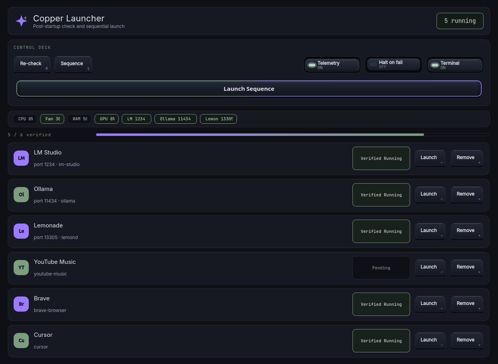
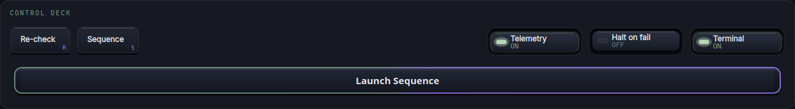
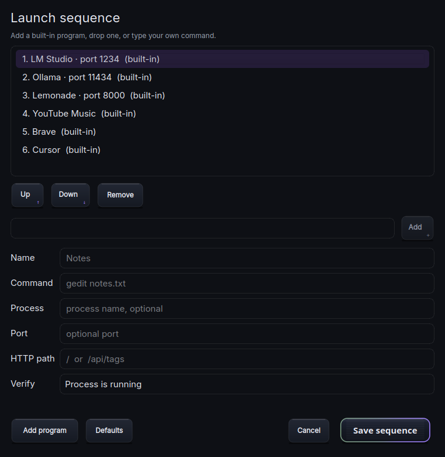

# Copper Launcher

Copper Launcher is a native Ubuntu desktop app that checks the machine, then starts a lineup of programs one at a time. If something is already running, it is left alone.



The default lineup is LM Studio, Ollama, Lemonade, YouTube Music, Brave, and Cursor. The window stays responsive while it checks ports and starts each program.

## Control deck



Three kinds of controls sit in the deck:

| Control | What it does |
| --- | --- |
| **Launch Sequence** | Starts the lineup in order and waits until each step is verified. The rim cycles between violet and sage. |
| **Re-check** | Reads CPU, fan, memory, GPU, and the ports again without starting anything. |
| **Sequence** | Opens the editor for the lineup. |
| **Telemetry** | Latches the live readings on or off. |
| **Halt on fail** | Stops the sequence at the first program that does not come up. |
| **Terminal** | Opens or closes the log drawer. |

Each program card has its own **Launch** and **Remove** keys. Status pills read **Pending**, **Checking...**, **Launching...**, **Verified Running**, or **Failed**.

The strip under the deck shows CPU load, fan speed, memory, GPU, and whether LM Studio (`1234`), Ollama (`11434`), and Lemonade are accepting connections.

## Edit the lineup



**Up**, **Down**, and **Remove** change the order. **Add** puts a built-in program back. The form at the bottom adds any other command, with an optional port and a check for a running process, an open port, or an HTTP response.

**Save sequence** writes the lineup to `~/.config/copper-launcher/sequence.json`. **Defaults** restores the original six. Removing a card from the main window saves immediately.

## Install

```bash
python3 -m venv .venv
.venv/bin/pip install -r requirements.txt
.venv/bin/python copper_launcher.py
```

Add `--auto-start` to run the sequence as soon as the window opens:

```bash
.venv/bin/python copper_launcher.py --auto-start
```

## Pin it to the dock

Edit the two paths in `copper-launcher.desktop` so they point at this checkout, then:

```bash
mkdir -p ~/.local/share/applications
cp copper-launcher.desktop ~/.local/share/applications/
```

Search for **Copper Launcher** in Activities and pin it.

To start it at login, edit `copper-launcher-autostart.desktop` the same way and copy it to `~/.config/autostart/`. That file already waits 8 seconds and passes `--auto-start`.

## Where to change ports and programs

Overrides for executables, ports, and the built-in catalog are at the top of `copper_launcher.py`.

| Setting | Default |
| --- | --- |
| LM Studio port | `1234` |
| Ollama port | `11434` |
| Lemonade port | `8000` (an existing server on `13305` still counts as running) |
| YouTube Music | `youtube-music`, a Flatpak, or a Brave app shortcut named YouTube Music |
| Launch log | `~/.local/state/copper-launcher/logs/` |

Ollama is started with `systemctl start ollama` when that service exists. Otherwise the launcher runs `ollama serve`.

## Fonts

The interface uses [Inter](https://github.com/rsms/inter) and the readouts use [JetBrains Mono](https://github.com/JetBrains/JetBrainsMono). Both are included under the SIL Open Font License. The license texts are `fonts/OFL-Inter.txt` and `fonts/OFL-JetBrainsMono.txt`.
